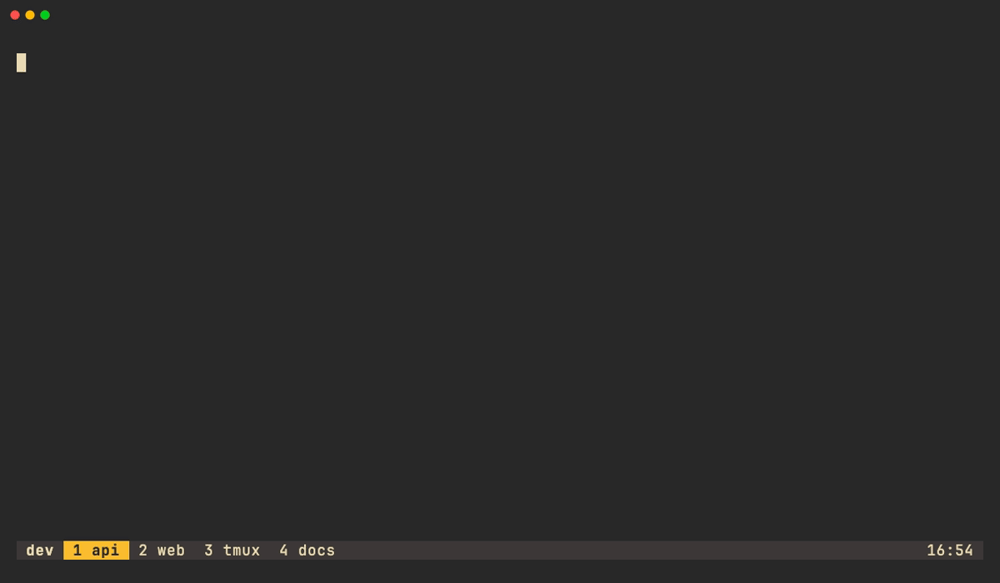
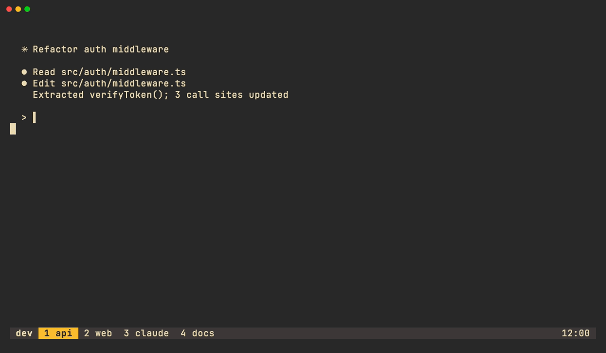

English | [Korean](README.ko.md)

# tmux-oil.nvim


**Edit your tmux windows like text.** One line per window, sessions as headers, `:w` applies.



## Why

[oil.nvim](https://github.com/stevearc/oil.nvim) turns a directory into a buffer: you edit text, and the file system follows. tmux-oil.nvim applies the same model to tmux windows. The buffer is the desired state, and `:w` reconciles tmux with it after showing you every action. A line's identity is a hidden `@id` anchor, not its name, so names can contain anything. There are no heuristics: a line with its anchor is that window, a line without one is a new window, and a missing line is a kill.

## Features

- Rename a window by editing its line
- Reorder windows with `ddp`
- Move a window to another session by moving its line under that session's header
- Kill a window with `dd`
- Create a window by typing a new line
- Create a session with a line ending in `/`, windows typed or moved under it go in
- An empty name keeps tmux `automatic-rename` on
- oil-style confirmation that lists every action before anything runs
- Windows created outside the buffer are never killed
- Program icons taken from the active pane
- The cursor lands on your current window
- Optional follow-cursor live preview in the popup

## Requirements

- Neovim ≥ 0.10
- tmux ≥ 3.3
- A Nerd Font (optional, for icons; see [Icons](#icons))
- `python3` (only for the popup launcher)

No Lua dependencies. [nvim-web-devicons](https://github.com/nvim-tree/nvim-web-devicons) is used for icon colours when present.

## Installation

[lazy.nvim](https://github.com/folke/lazy.nvim):

```lua
{ "minhyeoky/tmux-oil.nvim", opts = {} }
```

### tmux popup

The popup is sized to its content (sessions, windows, longest line), clamped to the client. `display-popup` takes its size at launch, so `bin/tmux-oil-popup` computes it before nvim starts:

```tmux
bind s run-shell "~/.local/share/nvim/lazy/tmux-oil.nvim/bin/tmux-oil-popup"
```

The path is lazy.nvim's default install dir; with another plugin manager, point it at the plugin's `bin/tmux-oil-popup`. `prefix s` replaces tmux's built-in session chooser (`choose-tree`); pick another key if you want to keep it.

Border and title are `display-popup` flags, passed through:

```tmux
bind s run-shell "~/.local/share/nvim/lazy/tmux-oil.nvim/bin/tmux-oil-popup --border rounded --border-style 'fg=#665c54' --title ''"
```

`--border` takes `single`, `rounded`, `double`, `heavy`, `simple`, `padded` or `none`; without it tmux's `popup-border-lines` option applies. `--title ''` drops the title from the top edge.

Fixed size instead:

```tmux
bind T display-popup -E -w 80% -h 80% "nvim -c 'lua require(\"tmux-oil\").open({ popup = true })'"
```

## Usage

Open the buffer with:

- `:TmuxOil`
- a mapping of your own, for example `vim.keymap.set("n", "<leader>tw", "<cmd>TmuxOil<cr>")`
- `prefix s` in tmux, using the popup binding above

The only editable text is the window or session **name**. Everything else (index, icon, title, pane count) is virtual text. At open the cursor is on the window the client is on (needs `$TMUX`; otherwise line 1). `R` keeps the cursor on the same window, or the same line number if that window is gone.

### Keys (buffer-local)

| Key | Action |
|---|---|
| `<CR>` | switch to the window under the cursor (closes the popup) |
| `q` | close (asks if there are unsaved edits) |
| `R` | reload from tmux |
| `gc` | toggle cwd column |
| `gt` | copy the pane title into the name |
| `cc` `S` | clear the name and retype it (the window is kept) |
| `0` `^` `I` | go to / insert at the start of the name |
| `g?` | help |
| `:w` `:wq` `:x` | review and apply (`:wq`, `:x` then close) |

In the confirmation float: `y` `Y` `o` `O` accept; `n` `N` `c` `C` `q` `<Esc>` `<C-c>` cancel.

### Edits

A line's identity is its hidden `$N` / `@N` anchor at the start of the line (leading spaces are ignored). Any edit that keeps it (`cw`, `cc`, `:s`, `ddp`) edits that window; deleting the whole line kills it; a line without an anchor creates a window.

| Edit | tmux command |
|---|---|
| Change a window's name | `rename-window` |
| Change a session's name | `rename-session` |
| Empty a window's name | `set-option -w automatic-rename on` |
| Move a line (`ddp`) | `move-window` (order) |
| Move a line under another session header | `move-window` (across sessions) |
| Delete a line (`dd`) | `kill-window` (`kill-session` for a session header) |
| Write a new line | `new-window` (without `-n` when the name is empty) |
| Write a line ending in `/` | `new-session` (windows below it are created or moved into it; no `:` or `.` in the name) |

### Follow cursor (popup only)

With `follow_cursor = true`, moving the cursor onto a window line selects that window behind the popup, switching sessions when needed. Session lines do nothing.



- `q`, `:q` and any other close without `<CR>` put the client back on the window the popup was opened from; `<CR>` keeps the selection.
- `:w` that kills the followed window restores the origin first (skipped if the origin is killed too).
- Ignored outside a popup, where selecting a window would leave nvim's own window.

## Configuration

```lua
require("tmux-oil").setup({
  skip_confirm = false,   -- apply on :w without the confirmation float
  icons = true,           -- true (Nerd Font / devicons) | "ascii" | false
  icon_map = {},          -- command → "glyph" | { icon = "", hl = "Group" } | { key = "py" } (devicons key)
  show_cwd = false,       -- show the cwd column (toggle per buffer with gc)
  indent = 0,             -- spaces before a window's index; sessions are separated by a rule
  socket = nil,           -- tmux -L <socket>
  preview_delay = 40,     -- ms of insert-mode typing before marks and the preview redraw; normal-mode edits redraw at once; 0 = always immediately
  follow_cursor = false,  -- popup only: select the window under the cursor; cancel restores the origin
  follow_delay = 0,       -- ms the cursor must rest before following; 0 = on every line change
})
```

## Icons

The icon follows the active pane's `pane_current_command` (exact match). Colours come from nvim-web-devicons when installed, otherwise `Special`.

| Command | Icon |
|---|---|
| `claude` `claude.exe` `codex` `opencode` `aider` `pi` `gemini` `amp` `goose` `crush` `copilot` | 󰚩 (`TmuxOilAgent`) |
| `zsh` `bash` `sh` `fish` | shell |
| `nvim` `vim` `vi` | vim |
| `python` `python3` `uv` `ipython` | py |
| `node` `bun` `deno` `npm` `pnpm` `yarn` | js |
| `go` / `cargo` `rustc` / `lua` | go / rs / lua |
| `git` `lazygit` `gh` `tig` | git |
| `docker` `docker-compose` `kubectl` `k9s` | Dockerfile |
| `make` `cmake` `ninja` | Makefile |
| `tail` `less` `journalctl` | log |
| `tmux` | tmux |
| `ssh` `mosh` | 󰣀 (`DiagnosticWarn`) |
| `htop` `btop` `top` | monitor (`Comment`) |

Fallback ladder:

- Any other command gets no icon; the column stays blank so names stay aligned.
- No Nerd Font: `icons = "ascii"` shows `ai`, `sh`, `vi`, `py`, `js`, `go`, `rs`, `lua`, `git`, `dk`, `mk`, `log`, `tm`, `ssh`, `top`.
- `icons = false` removes the icon column.

## How it works

1. **Read.** The plugin reads sessions and windows from tmux.
2. **Render.** Each object becomes a line that starts with a concealed anchor (`$N` / `@N`); index, icon, title and pane count are virtual text.
3. **Edit.** Anything goes; marks and a preview of the pending action follow your edits.
4. **Parse.** On `:w` the buffer is parsed back into lines with anchors, lines without, and the sessions they sit under.
5. **Diff.** The result is compared against a fresh read of tmux, not the stale one shown, so windows created elsewhere meanwhile are never killed.
6. **Apply.** Actions run one at a time in a fixed order: rename → new → move → kill. Before moving windows out of a session, a placeholder window keeps that session alive (tmux destroys a session when its last window leaves) and is removed afterwards. The window running nvim is killed last.

If the tmux server restarted since the buffer was rendered, `:w` refuses and asks you to press `R`.

## Limitations

- Pane layout is not editable; the pane count is display only.
- Linked windows (one window in several sessions) are unsupported.
- `bin/tmux-oil-popup` measures names and titles with East Asian widths and hides a title equal to the host name, like the buffer does. It does not read your Lua config: with `show_cwd = true`, `indent > 0`, `icons = "ascii"` or `ambiwidth=double` the popup may be a few columns too narrow (the buffer has `nowrap`, so long lines are cut, not wrapped).
- A name that itself looks like an anchor (`$9`, `@9x`) cannot be typed as a new window or session: the line is read as that id. A window name cannot end in `/`.
- tmux < 3.3 is not supported.

## Development

```sh
make test   # isolated tmux server: tmux -L tmux-oil-test
```

Tests never touch your default tmux server. The demo in `demo/` runs against its own server (`tmux -L tmux-oil-demo`) and is recorded with [VHS](https://github.com/charmbracelet/vhs):

```sh
vhs demo/demo.tape     # from the repo root: writes demo/demo.gif, demo/demo.mp4 and demo/frames/
vhs demo/follow.tape   # demo/follow.gif
```

The recording needs VHS (with ttyd and ffmpeg), zsh, JetBrainsMono Nerd Font, and reads gruvbox.nvim and nvim-web-devicons from `~/.local/share/nvim/lazy/` when they are there. `demo/setup.sh` links `demo/nvim/init.lua` into `~/.config/tmux-oil-demo/`.

## Related

- [oil.nvim](https://github.com/stevearc/oil.nvim): the file system version of this idea, and the inspiration.
- [asdf8601/tmux-oil.nvim](https://github.com/asdf8601/tmux-oil.nvim): a pane-per-line take on the same idea.
- [tmux-sessionizer](https://github.com/ThePrimeagen/tmux-sessionizer) and [sesh](https://github.com/joshmedeski/sesh): session switchers, for jumping rather than editing.

## License

[MIT](LICENSE)
